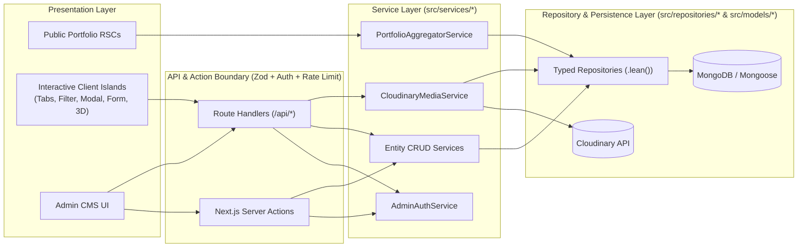

# Target Architecture & Dependency Decision Plan — Tamjid Portfolio V2

---

## 1. Architectural Overview

Tamjid Portfolio V2 migrates the static HTML/CSS/JS portfolio into a full-stack **Next.js (App Router)** application backed by **MongoDB (Mongoose)** and **Cloudinary**, featuring a secure **Admin CMS**, **Dark/Light theming**, and **progressive Three.js / WebGL enhancements**.

### Layered Architecture Principles



1. **Strict Separation of Concerns:**
   - **UI Components (`src/components/`)** never import Mongoose models or database connections.
   - **Repositories (`src/repositories/`)** encapsulate all Mongoose queries, projections, sorting, indexing, and `.lean()` transformations into plain TypeScript DTOs.
   - **Services (`src/services/`)** implement domain logic, caching/revalidation triggers (`revalidateTag` / `revalidatePath`), media reference checks before deletion, and fallback seed synthesis when the database is unconfigured or unreachable.
   - **Validation (`src/lib/validation/`)** enforces strict **Zod** schemas on every API request, Server Action payload, and environment configuration.

---

## 2. Target Directory Structure

```text
src/
├── app/
│   ├── (public)/
│   │   ├── layout.tsx              # Public portfolio shell & metadata
│   │   ├── page.tsx                # Server-rendered portfolio entry point
│   │   └── loading.tsx             # Non-shifting skeleton state
│   ├── admin/
│   │   ├── login/page.tsx          # Rate-limited admin login page
│   │   └── (protected)/
│   │       ├── layout.tsx          # Authenticated Admin CMS shell & sidebar
│   │       ├── dashboard/page.tsx  # Overview stats & quick actions
│   │       ├── profile/page.tsx    # Profile & contact info editor
│   │       ├── about/page.tsx      # About narrative, services, testimonials, clients
│   │       ├── resume/page.tsx     # Education, experience, skills, achievements
│   │       ├── projects/page.tsx   # Portfolio projects & categories manager
│   │       ├── blog/page.tsx       # Blog posts manager
│   │       ├── media/page.tsx      # Cloudinary media library & reference tracker
│   │       ├── messages/page.tsx   # Contact form submissions inbox
│   │       ├── navigation/page.tsx # Navbar & social links editor
│   │       └── settings/page.tsx   # Site settings, SEO, theme & 3D toggles
│   ├── api/
│   │   ├── auth/                   # Login, logout, session check endpoints
│   │   ├── admin/                  # Protected CRUD & reorder endpoints
│   │   ├── public/                 # Public contact submission & health check
│   │   └── uploads/                # Cloudinary signed upload & asset management
│   ├── layout.tsx                  # Root HTML/Body + ThemeProvider + Poppins font
│   ├── globals.css                 # Preserved original CSS + semantic theme variables
│   ├── not-found.tsx               # Styled 404 page
│   ├── robots.ts                   # Dynamic robots.txt (disallows /admin, /api)
│   └── sitemap.ts                  # Dynamic sitemap.xml
├── components/
│   ├── portfolio/                  # Sidebar, Navbar, About, Resume, Portfolio, Blog, Contact
│   ├── animations/                 # Lazy-loaded Three.js canvas & reduced-motion fallbacks
│   ├── theme/                      # ThemeProvider & subtle ThemeToggle button
│   ├── admin/                      # Admin sidebar, forms, tables, media picker, dialogs
│   └── ui/                         # Ionicon SVG renderer, toast, modal primitives
├── lib/
│   ├── mongodb/                    # Cached Mongoose connection singleton
│   ├── cloudinary/                 # Server-side signature generator & URL transformer
│   ├── auth/                       # Password hashing (scrypt/Argon2), HMAC/JWT HttpOnly session cookies, rate limiter
│   ├── cache/                      # Next.js unstable_cache & tag invalidation helpers
│   ├── validation/                 # Centralized Zod schemas for all entities
│   ├── security/                   # CSRF origin verification, sanitization, headers
│   └── utils/                      # Serialization & helper utilities
├── models/                         # Mongoose schemas (Profile, Project, Skill, etc.)
├── repositories/                   # Data access layer returning plain DTOs
├── services/                       # Business logic & cache invalidation orchestration
├── seed/                           # Idempotent initial seed data matching V1 index.html
└── types/                          # Centralized TypeScript interfaces & DTOs
```

---

## 3. Database Schema Architecture (MongoDB & Mongoose)

Rather than storing the entire website in a single monolithic document, content is partitioned into cohesive, indexed collections:

1. **`SiteSettings` (Singleton Collection):** `siteTitle`, `siteDescription`, `faviconUrl`, `faviconPublicId`, `defaultTheme` (`"dark"` | `"light"`), `enableThemeToggle`, `enableThreeD`, `mapEmbedUrl`, `contactFormTitle`, `contactSubmitLabel`, `googleScriptWebhookUrl`, `seoKeywords`, `ogImageUrl`.
2. **`Profile` (Singleton Collection):** `fullName`, `professionalTitle`, `avatarUrl`, `avatarPublicId`, `avatarAlt`, `email`, `phone`, `phoneHref`, `birthdayDisplay`, `birthdayDateTime`, `location`, `showContactsLabel`, `aboutHeading`, `aboutParagraphs` (`string[]`), `servicesHeading`, `testimonialsHeading`, `clientsHeading`.
3. **`SocialLink` Collection:** `platform`, `url`, `iconName`, `displayOrder`, `visible`. Indexed on `{ visible: 1, displayOrder: 1 }`.
4. **`NavigationItem` Collection:** `label`, `slug` (`"about"` | `"resume"` | `"portfolio"` | `"blog"` | `"contact"`), `displayOrder`, `visible`, `isDefault`. Indexed on `{ visible: 1, displayOrder: 1 }`.
5. **`Service` Collection:** `title`, `description`, `iconUrl`, `iconPublicId`, `iconAlt`, `displayOrder`, `visible`. Indexed on `{ visible: 1, displayOrder: 1 }`.
6. **`Testimonial` Collection:** `clientName`, `company`, `designation`, `avatarUrl`, `avatarPublicId`, `avatarAlt`, `text`, `dateDisplay`, `dateISO`, `displayOrder`, `status` (`"published"` | `"draft"`). Indexed on `{ status: 1, displayOrder: 1 }`.
7. **`ClientLogo` Collection:** `name`, `logoUrl`, `logoPublicId`, `logoAlt`, `websiteUrl`, `displayOrder`, `visible`. Indexed on `{ visible: 1, displayOrder: 1 }`.
8. **`Education` Collection:** `institution`, `degree`, `department`, `dateRange`, `description`, `logoUrl`, `logoPublicId`, `displayOrder`, `visible`. Indexed on `{ visible: 1, displayOrder: 1 }`.
9. **`Experience` Collection:** `position`, `company`, `employmentType`, `location`, `dateRange`, `isCurrent`, `description`, `responsibilities`, `technologies`, `logoUrl`, `logoPublicId`, `displayOrder`, `visible`. Indexed on `{ visible: 1, displayOrder: 1 }`.
10. **`Skill` Collection:** `name`, `category`, `percentageValue` (`0–100`), `percentageLabel` (e.g., `"80%"` or `"60%"` to preserve V1's exact display label), `iconName`, `displayOrder`, `visible`. Indexed on `{ visible: 1, displayOrder: 1 }`.
11. **`Achievement` Collection:** `title`, `issuer`, `dateDisplay`, `description`, `certificateImageUrl`, `certificatePublicId`, `verificationUrl`, `displayOrder`, `status` (`"published"` | `"draft"`). Indexed on `{ status: 1, displayOrder: 1 }`.
12. **`Project` Collection:** `title`, `slug` (unique), `category` (display string), `filterCategory` (lowercase normalized), `shortDescription`, `fullDescription`, `thumbnailUrl`, `thumbnailPublicId`, `thumbnailAlt`, `gallery`, `technologies`, `liveUrl`, `githubUrl`, `featured`, `displayOrder`, `status` (`"published"` | `"draft"`). Indexed on `{ status: 1, displayOrder: 1 }` and `{ slug: 1 }`.
13. **`BlogPost` Collection:** `title`, `slug` (unique), `category`, `publishedDateDisplay`, `publishedDateISO`, `excerpt`, `content`, `bannerUrl`, `bannerPublicId`, `bannerAlt`, `externalUrl`, `displayOrder`, `status` (`"published"` | `"draft"`). Indexed on `{ status: 1, displayOrder: 1 }`.
14. **`ContactMessage` Collection:** `fullname`, `email`, `message`, `isRead`, `ipHash`, `createdAt`. Indexed on `{ isRead: 1, createdAt: -1 }`.
15. **`MediaAsset` Collection:** `publicId` (unique), `url`, `secureUrl`, `folder`, `resourceType`, `format`, `width`, `height`, `bytes`, `altText`, `createdAt`. Indexed on `{ folder: 1, createdAt: -1 }` and `{ publicId: 1 }`.
16. **`AdminUser` & `AdminSession` Collections:** Stores provisioned admin credentials (`email`, `passwordHash`, `role`, `failedLoginAttempts`, `lockedUntil`) and server-revocable sessions (`tokenHash`, `userId`, `expiresAt`, `ipAddress`, `userAgent`).

---

## 4. Dependency Decision Document (Section 4 Requirement)

| Category | Chosen Technology | Version Target | Justification & Alternatives Considered |
| :--- | :--- | :--- | :--- |
| **Framework** | **Next.js (App Router)** + **React** + **TypeScript** | Next.js 15.x / React 19.x / TS 5.x | First-class React Server Components, `next/font/google` (`Poppins`), `next/image`, tag-based cache revalidation (`unstable_cache` / `revalidateTag`), and Route Handlers without needing a separate Express backend. |
| **Styling** | **Preserved Native CSS (`globals.css`) + Scoped CSS / Minimal Utilities** | Native CSS Custom Properties | **Critical Decision:** The original `assets/css/style.css` (`1,882` lines) uses intricate pseudo-element gradient borders and 5 non-standard breakpoints (`450px`, `580px`, `768px`, `1024px`, `1250px`). Rewriting these in Tailwind would risk visual regressions. Preserving the exact CSS rules for the public portfolio guarantees 1:1 visual fidelity while scoped admin styles power the separate `/admin` dashboard. |
| **Database & ODM** | **MongoDB** + **Mongoose** | Mongoose 8.x | Strongly typed schemas, built-in validation boundaries, index management, and `.lean()` query performance. |
| **Validation** | **Zod** | Zod 3.x | Composable runtime validation for API payloads, Server Actions, and environment variables with zero-cost TypeScript type inference. |
| **Authentication & Password Hashing** | **`@node-rs/argon2` (or Node `crypto.scrypt` fallback) + `jose` / HMAC Session Cookies** | Native / Standard | Server-backed session records (`AdminSession`) paired with signed `HttpOnly`, `Secure`, `SameSite=Lax` cookies allow instant server-side session revocation and brute-force lockout without heavy third-party auth bloat. |
| **Media Storage** | **Cloudinary REST/Signing API** | Server-side SHA-1/SHA-256 signing + `next/image` | Generates signed upload parameters on the server (`src/lib/cloudinary/`) and stores `publicId` + metadata in MongoDB (`MediaAsset`), avoiding bloated client SDKs. |
| **3D & Motion** | **Three.js / React Three Fiber (`@react-three/fiber`, `@react-three/drei`)** + **CSS / Framer Motion** | `three`, `@react-three/fiber`, `framer-motion` | Dynamically imported (`next/dynamic` with `ssr: false`) subtle interactive particle/geometric depth field in the background/sidebar aura that pauses offscreen and respects `prefers-reduced-motion`. |
| **Icons** | **Custom Inline Ionicons v5.5.2 SVG Component + `lucide-react` (Admin only)** | Built-in SVG map + `lucide-react` | Inline SVG paths matching the exact 12 Ionicons from `index.html` eliminate the external `unpkg.com` script waterfall while preserving identical stroke widths. `lucide-react` is used only in `/admin`. |
| **Testing** | **Vitest** + **React Testing Library** + **Playwright** | Vitest + Playwright | Fast unit/integration tests for models, repositories, services, auth, and components via Vitest, plus end-to-end and multi-viewport visual regression verification via Playwright / headless Chrome. |

---

## 5. Caching, Security & Three.js Integration Summary

### 5.1 Caching & Revalidation
- Public portfolio queries are wrapped in `unstable_cache` tagged with `portfolio-public` and granular section tags (`portfolio-profile`, `portfolio-projects`, `portfolio-resume`, `portfolio-blog`, `portfolio-settings`).
- Every authenticated Admin CMS mutation calls `revalidateTag('portfolio-public')` and `revalidatePath('/')` immediately after committing to MongoDB.
- Admin routes (`/admin/*`, `/api/admin/*`) enforce `export const dynamic = 'force-dynamic'` and `Cache-Control: no-store`.

### 5.2 Security Controls
- **No Public Registration:** Admin accounts are provisioned solely via idempotent server seed script (`npm run seed:admin`) reading environment credentials.
- **Independent Authorization:** Every `/api/admin/*` route and Server Action independently invokes `requireAdminSession()` before executing any service or repository call.
- **Rate Limiting & Lockout:** Login attempts and public contact submissions are rate-limited by IP and account lockout counters.
- **Reference-Safe Media Deletion:** `CloudinaryMediaService.deleteAsset(publicId)` checks all content collections (`Profile`, `Service`, `Testimonial`, `ClientLogo`, `Project`, `BlogPost`, `Achievement`) and blocks deletion if the asset is still referenced.

### 5.3 Three.js / WebGL Enhancement Strategy
- A lightweight, non-intrusive 3D ambient particle/wireframe canvas is rendered behind the main layout container (`.smoky-black` backdrop) using `next/dynamic(..., { ssr: false })`.
- Strictly respects `prefers-reduced-motion: reduce`, `SiteSettings.enableThreeD`, `IntersectionObserver` / `document.visibilityState` pause controls, and WebGL context error boundaries (`webglcontextlost`), guaranteeing zero impact on layout shifts (CLS = `0`) or original component dimensions.
