# Content Inventory & Component-Data Dependency Map — Tamjid Portfolio V2

This document catalogs every piece of content in the original `index.html`, classifies whether it is static or database-driven in V2, maps it to its target MongoDB collection/model, and records the exact initial seed values so V2 renders identically to V1 out-of-the-box.

---

## 1. Component & Content Dependency Map

```mermaid
flowchart TD
    subgraph PublicLayout["Public Portfolio Shell (Server Component)"]
        Sidebar["Sidebar Component"]
        Navbar["Navbar Component"]
        AboutPage["About Article (Tab 1)"]
        ResumePage["Resume Article (Tab 2)"]
        PortfolioPage["Portfolio Article (Tab 3)"]
        BlogPage["Blog Article (Tab 4)"]
        ContactPage["Contact Article (Tab 5)"]
    end

    subgraph Collections["MongoDB Collections"]
        SiteSettings[("SiteSettings")]
        Profile[("Profile")]
        SocialLinks[("SocialLink[]")]
        NavItems[("NavigationItem[]")]
        Services[("Service[]")]
        Testimonials[("Testimonial[]")]
        Clients[("ClientLogo[]")]
        Education[("Education[]")]
        Experience[("Experience[]")]
        Skills[("Skill[]")]
        Achievements[("Achievement[]")]
        Projects[("Project[]")]
        BlogPosts[("BlogPost[]")]
        ContactMessages[("ContactMessage[]")]
        MediaAssets[("MediaAsset[]")]
    end

    Sidebar --> Profile
    Sidebar --> SocialLinks
    Navbar --> NavItems
    Navbar --> SiteSettings
    AboutPage --> Profile
    AboutPage --> Services
    AboutPage --> Testimonials
    AboutPage --> Clients
    ResumePage --> Education
    ResumePage --> Experience
    ResumePage --> Skills
    ResumePage --> Achievements
    PortfolioPage --> Projects
    BlogPage --> BlogPosts
    ContactPage --> SiteSettings
    ContactPage --> ContactMessages
    Profile -.-> MediaAssets
    Services -.-> MediaAssets
    Testimonials -.-> MediaAssets
    Clients -.-> MediaAssets
    Projects -.-> MediaAssets
    BlogPosts -.-> MediaAssets
```

---

## 2. Exhaustive Section-by-Section Content Catalog

### 2.1 Document Metadata & Global Site Settings (`SiteSettings` Model)

| Field | Original Value in `index.html` | Target Model Field | Editable in Admin? |
| :--- | :--- | :--- | :--- |
| Document `<title>` | `MD. Tamjid Hossain` | `SiteSettings.siteTitle` | Yes |
| Favicon | `./assets/images/icon.svg` | `SiteSettings.faviconUrl` / `faviconPublicId` | Yes |
| Default Theme | Dark (`--smoky-black` / `--eerie-black-2`) | `SiteSettings.defaultTheme` (`"dark"`) | Yes |
| Allow Theme Toggle | Implicit (New in V2) | `SiteSettings.enableThemeToggle` (`true`) | Yes |
| Enable 3D Hero/Background | Implicit (New in V2) | `SiteSettings.enableThreeD` (`true`) | Yes |
| Google Maps Embed URL | `https://www.google.com/maps/embed?pb=!1m18!1m12!1m3!1d10009.658163939283!2d-113.96869938501997!3d51.156146554192574!2m3!1f0!2f0!3f0!3m2!1i1024!2i768!4f13.1!3m3!1m2!1s0x537163d907633bcd%3A0x18a143854b867573!2sSkyview%20Ranch%2C%20Calgary%2C%20AB%2C%20Canada!5e0!3m2!1sen!2sbd!4v1777137169843!5m2!1sen!2sbd` | `SiteSettings.mapEmbedUrl` | Yes |
| Contact Form Heading | `Contact Form` | `SiteSettings.contactFormTitle` | Yes |
| Contact Submit Label | `Send Message` | `SiteSettings.contactSubmitLabel` | Yes |

---

### 2.2 Sidebar — Profile & Contact Details (`Profile` Model)

| Element | Original Value | Target Model Field | Notes |
| :--- | :--- | :--- | :--- |
| Avatar Image | `./assets/images/my-avatar.jpg` (`width="80"`, `alt="MD. Tamjid Hossain"`) | `Profile.avatarUrl`, `Profile.avatarPublicId`, `Profile.avatarAlt` | 460x460 JPEG |
| Full Name (`h1.name`) | `MD. Tamjid Hossain` | `Profile.fullName` | Also sets `title` attribute |
| Professional Title (`p.title`) | `IT enthusiast` | `Profile.professionalTitle` | Rendered inside `.onyx` badge |
| Toggle Button Label | `Show Contacts` (`ion-icon="chevron-down"`) | `Profile.showContactsLabel` | |
| Contact 1 — Email | Label: `Email`, Value: `mdtamjidhossain.ca@gmail.com`, Href: `mailto:mdtamjidhossain.ca@gmail.com`, Icon: `mail-outline` | `Profile.email` | |
| Contact 2 — Phone | Label: `Phone`, Value: `123456789`, Href: `tel:+123456789`, Icon: `phone-portrait-outline` | `Profile.phone`, `Profile.phoneHref` | |
| Contact 3 — Birthday | Label: `Birthday`, Display: `March 19, 2015`, `datetime="1982-06-23"`, Icon: `calendar-outline` | `Profile.birthdayDisplay`, `Profile.birthdayDateTime` | Preserves original text & datetime attribute |
| Contact 4 — Location | Label: `Location`, Display: `Canda`, Icon: `location-outline` | `Profile.location` | Seeded as `"Canda"` to match V1; editable in Admin |

---

### 2.3 Sidebar — Social Links (`SocialLink` Collection)

| Order | Platform | Icon Name | Original `href` | Visible |
| :---: | :--- | :--- | :--- | :---: |
| 1 | GitHub | `logo-github` | `https://github.com/tamjid-ca` | `true` |
| 2 | LinkedIn | `logo-linkedin` | `https://www.linkedin.com/in/md-tamjid-hossain-alca/` | `true` |
| 3 | Facebook | `logo-facebook` | `#` | `true` |

---

### 2.4 Main Content — Navigation Bar (`NavigationItem` Collection)

| Order | Label | `data-page` Target Slug | Default Active | Visible |
| :---: | :--- | :--- | :---: | :---: |
| 1 | `About` | `about` | `true` | `true` |
| 2 | `Resume` | `resume` | `false` | `true` |
| 3 | `Portfolio` | `portfolio` | `false` | `true` |
| 4 | `Blog` | `blog` | `false` | `true` |
| 5 | `Contact` | `contact` | `false` | `true` |

---

### 2.5 Tab 1: About (`Profile` / `Service` / `Testimonial` / `ClientLogo` Models)

#### 2.5.1 About Heading & Biography (`Profile` Model)
- **Heading (`h2.article-title`):** `About me` (`Profile.aboutHeading`)
- **Paragraph 1 (`Profile.aboutParagraphs[0]`):**
  > I’m a Technology Explorer and Java & Python Practitioner from ALCA, currently in Grade 5. I enjoy building creative projects, learning programming, and turning ideas into fun, interactive experiences through technology and design. I work with C, C++, HTML, CSS, JavaScript, Python, Dart, and Flutter, and I also use Git and GitHub to manage and share my projects.
- **Paragraph 2 (`Profile.aboutParagraphs[1]`):**
  > My goal is to build websites that are functional, user-friendly, and visually attractive at the same time. I enjoy adding a personal touch to every project and making sure each design is eye-catching, modern, and easy to use. My aim is to bring ideas and identities to life in the most creative way possible while creating smooth digital experiences for users.

#### 2.5.2 Services Section (`Service` Collection)
- **Section Heading (`h3.service-title`):** `What i'm doing` (`Profile.servicesHeading`)

| Order | Title (`h4.service-item-title`) | Description (`p.service-item-text`) | Icon Image (`src`) | Icon `alt` |
| :---: | :--- | :--- | :--- | :--- |
| 1 | `Web design` | `The most modern and high-quality design made at a professional level.` | `/assets/images/my-avatar.jpg` | `design icon` |
| 2 | `Web development` | `High-quality development of sites at the professional level.` | `/assets/images/my-avatar.jpg` | `Web development icon` |
| 3 | `Mobile apps` | `Professional development of applications for iOS and Android.` | `/assets/images/my-avatar.jpg` | `mobile app icon` |
| 4 | `Photography` | `I make high-quality photos of any category at a professional level.` | `/assets/images/my-avatar.jpg` | `camera icon` |

#### 2.5.3 Testimonials Section & Modal (`Testimonial` Collection)
- **Section Heading (`h3.testimonials-title`):** `Testimonials` (`Profile.testimonialsHeading`)
- **Modal Quote SVG:** `/assets/images/icon-quote.svg` (`alt="quote icon"`)

| Order | Client Name (`h4`) | Avatar (`src`) | Date (`time`) | DateTime Attr | Testimonial Text | Published |
| :---: | :--- | :--- | :--- | :--- | :--- | :---: |
| 1 | `Daniel lewis` | `/assets/images/my-avatar.jpg` | `14 June, 2021` | `2021-06-14` | `Richard was hired to create a corporate identity. We were very pleased with the work done. She has a lot of experience and is very concerned about the needs of client. Lorem ipsum dolor sit amet, ullamcous cididt consectetur adipiscing elit, seds do et eiusmod tempor incididunt ut laborels dolore magnarels alia.` | `true` |
| 2 | `Jessica miller` | `/assets/images/my-avatar.jpg` | `14 June, 2021` | `2021-06-14` | `Richard was hired to create a corporate identity. We were very pleased with the work done. She has a lot of experience and is very concerned about the needs of client. Lorem ipsum dolor sit amet, ullamcous cididt consectetur adipiscing elit, seds do et eiusmod tempor incididunt ut laborels dolore magnarels alia.` | `true` |
| 3 | `Emily evans` | `/assets/images/my-avatar.jpg` | `14 June, 2021` | `2021-06-14` | `Richard was hired to create a corporate identity. We were very pleased with the work done. She has a lot of experience and is very concerned about the needs of client. Lorem ipsum dolor sit amet, ullamcous cididt consectetur adipiscing elit, seds do et eiusmod tempor incididunt ut laborels dolore magnarels alia.` | `true` |
| 4 | `Henry william` | `/assets/images/my-avatar.jpg` | `14 June, 2021` | `2021-06-14` | `Richard was hired to create a corporate identity. We were very pleased with the work done. She has a lot of experience and is very concerned about the needs of client. Lorem ipsum dolor sit amet, ullamcous cididt consectetur adipiscing elit, seds do et eiusmod tempor incididunt ut laborels dolore magnarels alia.` | `true` |

#### 2.5.4 Clients Section (`ClientLogo` Collection)
- **Section Heading (`h3.clients-title`):** `Clients` (`Profile.clientsHeading`)
- **Items (6 entries):** Orders 1–6, each with `name: "Client 1".."Client 6"`, `logoUrl: "/assets/images/my-avatar.jpg"`, `logoAlt: "client logo"`, `websiteUrl: "#"`, `visible: true`.

---

### 2.6 Tab 2: Resume (`Education`, `Experience`, `Skill`, `Achievement` Collections)

#### 2.6.1 Education Timeline (`Education` Collection)
- **Section Heading:** `Education` (Icon: `book-outline`)

| Order | Institution / Title (`h4`) | Date Range (`span`) | Description (`p.timeline-text`) | Visible |
| :---: | :--- | :--- | :--- | :---: |
| 1 | `ALCA` | `2021 — 2026` | `Currently studying at ALCA since 2021, developing knowledge, creativity, and technical skills.` | `true` |
| 2 | `""` (Empty placeholder row in V1) | `""` | `""` | `true` (Editable/Deletable in Admin) |
| 3 | `""` (Empty placeholder row in V1) | `""` | `""` | `true` (Editable/Deletable in Admin) |

#### 2.6.2 Experience Timeline (`Experience` Collection)
- **Section Heading:** `Experience` (Icon: `book-outline`)

| Order | Position / Title (`h4`) | Date Range (`span`) | Description (`p.timeline-text`) | Visible |
| :---: | :--- | :--- | :--- | :---: |
| 1 | `Creative director` | `2015 — Present` | `""` | `true` |
| 2 | `Art director` | `2013 — 2015` | `""` | `true` |
| 3 | `Web designer` | `2010 — 2013` | `""` | `true` |

#### 2.6.3 Skills Progress Section (`Skill` Collection)
- **Section Heading (`h3.skills-title`):** `My skills`

| Order | Skill Name (`h5`) | Display Label (`<data>`) | Progress Fill Width (`value` / `%`) | Category | Visible |
| :---: | :--- | :--- | :---: | :--- | :---: |
| 1 | `Python` | `80%` | `80` | `Programming` | `true` |
| 2 | `HTML` | `70%` | `70` | `Web` | `true` |
| 3 | `JavaScript` | `60%` | `90` (Note: V1 has `value="90"`/`width: 90%` and text `60%`) | `Web` | `true` |
| 4 | `WordPress` | `50%` | `50` | `CMS` | `true` |

#### 2.6.4 Achievements & Certifications (`Achievement` Collection — Optional/Expandable Section)
- **Behavior:** Not present in original `index.html`. When the `Achievement` collection has `0` published documents, the section is hidden so the Resume page looks 100% identical to V1. When the admin adds and publishes achievements/certifications in the Admin CMS, a matching timeline/card section renders gracefully in Resume.

---

### 2.7 Tab 3: Portfolio (`Project` Collection)

- **Article Heading (`h2.article-title`):** `Portfolio`
- **Filter Categories:** `All`, `Web design`, `Applications`, `Web development` (dynamically derived or managed alongside project categories).

| Order | Title (`h3.project-title`) | Slug | Category Display (`p.project-category`) | Filter Key (`data-category`) | Thumbnail (`src`) | Image `alt` | Live URL (`href`) | Published |
| :---: | :--- | :--- | :--- | :--- | :--- | :--- | :--- | :---: |
| 1 | `Finance` | `finance` | `Web development` | `web development` | `/assets/images/my-avatar.jpg` | `finance` | `#` | `true` |
| 2 | `Orizon` | `orizon` | `Web development` | `web development` | `/assets/images/my-avatar.jpg` | `orizon` | `#` | `true` |
| 3 | `Fundo` | `fundo` | `Web design` | `web design` | `/assets/images/my-avatar.jpg` | `fundo` | `#` | `true` |
| 4 | `Brawlhalla` | `brawlhalla` | `Applications` | `applications` | `/assets/images/my-avatar.jpg` | `brawlhalla` | `#` | `true` |
| 5 | `DSM.` | `dsm` | `Web design` | `web design` | `/assets/images/my-avatar.jpg` | `dsm.` | `#` | `true` |
| 6 | `MetaSpark` | `metaspark` | `Web design` | `web design` | `/assets/images/my-avatar.jpg` | `metaspark` | `#` | `true` |
| 7 | `Summary` | `summary` | `Web development` | `web development` | `/assets/images/my-avatar.jpg` | `summary` | `#` | `true` |
| 8 | `Task Manager` | `task-manager` | `Applications` | `applications` | `/assets/images/my-avatar.jpg` | `task manager` | `#` | `true` |
| 9 | `Arrival` | `arrival` | `Web development` | `web development` | `/assets/images/my-avatar.jpg` | `arrival` | `#` | `true` |

---

### 2.8 Tab 4: Blog (`BlogPost` Collection)

- **Article Heading (`h2.article-title`):** `Blog`

| Order | Title (`h3.blog-item-title`) | Category (`p.blog-category`) | Date Display (`<time>`) | DateTime Attr | Excerpt (`p.blog-text`) | Banner (`src`) | Banner `alt` | Link (`href`) | Published |
| :---: | :--- | :--- | :--- | :--- | :--- | :--- | :--- | :--- | :---: |
| 1 | `Design conferences in 2022` | `Design` | `Oct 15, 2023` | `2023-10-15` | `Veritatis et quasi architecto beatae vitae dicta sunt, explicabo.` | `/assets/images/my-avatar.jpg` | `Blog post` | `#` | `true` |
| 2 | `Design conferences in 2022` | `Design` | `Oct 15, 2023` | `2023-10-15` | `Veritatis et quasi architecto beatae vitae dicta sunt, explicabo.` | `/assets/images/my-avatar.jpg` | `Blog post` | `#` | `true` |
| 3 | `Design conferences in 2022` | `Design` | `Oct 15, 2023` | `2023-10-15` | `Veritatis et quasi architecto beatae vitae dicta sunt, explicabo.` | `/assets/images/my-avatar.jpg` | `Blog post` | `#` | `true` |
| 4 | `Design conferences in 2022` | `Design` | `Oct 15, 2023` | `2023-10-15` | `Veritatis et quasi architecto beatae vitae dicta sunt, explicabo.` | `/assets/images/my-avatar.jpg` | `Blog post` | `#` | `true` |

---

### 2.9 Tab 5: Contact (`SiteSettings` & `ContactMessage` Models)

- **Article Heading (`h2.article-title`):** `Contact`
- **Google Maps Iframe (`SiteSettings.mapEmbedUrl`):** Skyview Ranch, Calgary, AB, Canada (`width="600" height="450" loading="lazy" referrerpolicy="no-referrer-when-downgrade"`).
- **Form Fields:**
  - `fullname` (`type="text"`, `placeholder="Full name"`, `required`)
  - `email` (`type="email"`, `placeholder="Email address"`, `required`)
  - `message` (`textarea`, `placeholder="Your Message"`, `required`)
  - Submit button (`type="submit"`, initially `disabled` until `form.checkValidity()` is true; icon `paper-plane`, text `Send Message` -> `Sending...`).
- **V2 Backend Enhancement:** Submitting the contact form stores a validated `ContactMessage` document in MongoDB (viewable/manageable in the Admin CMS inbox) and optionally forwards to a configured Google Apps Script / webhook URL if set in `SiteSettings`.
